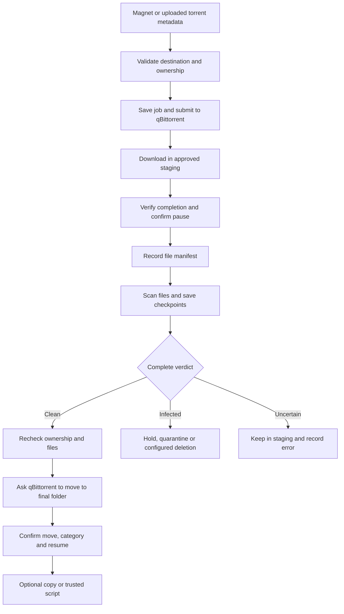

# Understanding the Rust implementation

## What this program does

Torrent Intake is a controller between qBittorrent and your media library. It
asks qBittorrent to download into a staging area, waits for a complete download,
pauses that torrent, scans its files, and only then chooses the configured final
action. SQLite remembers what happened so a restart does not erase its progress.

A useful first example is a download with three files: a media file, subtitles,
and cover art. The controller does not decide the whole download is clean after
scanning the media alone. Every regular file needs an acceptable verdict. An
attachment inside the media may also need a separate complete-object scan.



An important distinction is between **an infection** and **an incomplete
inspection**. ClamD being unavailable, a stale definitions database, an
unsupported attachment, or an archive exceeding a budget means inspection did
not finish. It is not a clean result and is not automatically an infection.

## Read the code in this order

1. `main.rs`: what happens before the server starts.
2. `config.rs`: how deployment settings become validated application values.
3. `workflow/mod.rs`: how a submitted job is represented and advanced.
4. `workflow/actions.rs`: how download placement and final actions work.
5. `workflow/scan.rs`: how a scan can stop and resume safely.
6. `scanning/mod.rs` and `scanning/protocol.rs`: how one file is inspected.
7. `persistence/db.rs` and `persistence/restore.rs`: how state survives restarts.
8. `http.rs`: how the browser reaches those operations.

Start with the ordinary successful flow. Then follow the early error returns.
Those returns are not incidental boilerplate: many of them enforce the rule that
files stay in staging until the controller has enough evidence to proceed.

## Rust ideas used here

### Values have owners

An owned `String` or `Vec<u8>` is responsible for its allocation. Passing
`&str` or `&[u8]` lends read-only access without copying the contents. For example,
the torrent parser reads a borrowed byte slice while computing the hash over the
exact original `info` dictionary bytes. Re-encoding that dictionary could change
its hash, so preserving the original byte range is essential.

`PathBuf` is an owned filesystem path; `&Path` is its borrowed form. These types
let containment checks compare path components. A string starting with
`/downloads` might actually mean `/downloads-other`; a component-based check
understands that those are separate directories.

### `Result` makes incomplete operations explicit

Most operations return `Result<T>`. `Ok(value)` carries the completed result;
`Err(error)` carries the reason the operation could not complete. A trailing
`?` means “if this failed, return that failure now; otherwise use its value.”

For example:

```rust,ignore
let metadata = std::fs::symlink_metadata(path)?;
```

A missing file does not become an empty file. The function returns an error.
Similarly, failing to read a ClamD reply does not produce an `Ok(clean)` result.
The scanner uses a dedicated `ScanError` enum so cancellation, policy limits and
service unavailability remain distinguishable.

### `Option` represents a legitimately missing value

An optional final category or missing torrent hash is represented as an optional
value rather than invented data. Missing information sometimes means “wait for
qBittorrent metadata,” and sometimes means “reject this operation.” The calling
function makes that decision explicitly.

The compatibility layer uses `serde_json::Value` for settings and database rows.
This preserves the original field names and nullable legacy columns. It is a
tradeoff: scanner internals have stronger compile-time types, while compatible
records need runtime validation at the module boundary. Small accessor functions
keep the conversion in one place, and configuration is validated before use.

### Shared ownership is different from unsynchronized access

`Arc<T>` lets multiple threads share a value without copying the underlying
object. It does not, by itself, allow unsafe mutation. A `Mutex<T>` protects
mutable shared state. An atomic flag handles simple cancellation requests.

The controller uses these tools for different jobs:

- A management mutex serializes decisions that could conflict, such as changing
  a planned destination while a final action is being reconciled.
- SQLite transactions make related durable updates commit together.
- Scan leases identify the worker currently allowed to publish a result.
- Cancellation flags let a paused controller stop blocking scan/helper work.
- A request guard increments and decrements the active mutation count even if
  a browser disconnects before receiving its response.

Keep locks around the smallest operation whose consistency they protect. A
network request does not become atomic just because a database transaction
exists; restart reconciliation still has to ask what qBittorrent actually did.

## Startup is a recovery protocol

The executable first obtains an exclusive controller lock in the local data
directory. It applies a staged restore before opening the normal application
database. It then reloads configuration, persists the effective settings, opens
SQLite, recovers interrupted work, and starts serving HTTP.

This order matters. Replacing the database while another thread still has it
open could mix old and new state. Applying a restore after starting workers
could let them act on the old installation before the replacement is ready.

A new installation starts paused. Restoring a backup also leaves the controller
paused. The operator verifies the receiving mounts and qBittorrent state before
resuming. A matching path string alone cannot prove that another machine has the
same content mounted there.

## How a submission becomes a durable job

The HTTP adapter accepts JSON magnets or a bounded multipart `.torrent` upload.
It validates the shape and size of the request before handing it to `Workflow`.
The workflow validates the destination, staging preference and custom tags.

An uploaded torrent is a recipe for downloading, not trusted content. The bounded
bencode parser checks structure, hash identity and unsafe file paths. The original
bytes are stored in SQLite and sent to qBittorrent unchanged. That retains
private-tracker data and v2 metadata and makes a retry possible after restart.

Each managed torrent has both the shared managed tag and a private per-job tag.
The shared tag identifies the controller's domain; the private tag identifies
this particular submission. Having the same torrent hash alone is insufficient
permission to move or delete a torrent someone else now owns.

## Why scans use manifests and checkpoints

A manifest records the files that belong to the completed torrent and their
filesystem identities. A useful identity includes the device, inode, size,
modification time and change time. A filename alone is not an identity: another
process could replace `media.mkv` with different bytes at the same path.

The scanner opens a regular file without following its final symlink. It compares
the open descriptor and pathname with the expected identity, streams from the
open descriptor, then verifies identity again. A result is reusable only while
its file identity, definitions identity and policy identity still match.

Per-file checkpoints mean a crash after nine out of ten files usually does not
require scanning all ten again. The interrupted file is handled conservatively.
The final manifest is checked again before the run is allowed to become clean.

A scan lease is a temporary claim recorded in SQLite. The worker renews it while
it is alive. An expired claim is recoverable after a crash. A worker that loses
ownership must not publish a verdict, even if its antivirus request finishes.

## Why large files need more than “split into chunks”

ClamD's native input limit is separate from the application's permitted media
size. Verified large media can use bounded overlapping windows. The overlap
helps short signatures crossing a boundary remain visible. It cannot preserve
every whole-file hash or parser context.

That is why the application records a distinct scan method, validates the media
container and stream table with FFprobe, and scans attachments as whole objects.
An arbitrary executable renamed to `.mkv` does not qualify. An unsupported data
track or unknown attachment also does not qualify merely because most of the
file is video.

Archives have their own bounded inspection route. Filenames inside an archive
are validated as metadata; they are never allowed to choose output paths. The
helper creates application-named temporary files, enforces shared expansion and
file-count budgets, and asks the parent to inspect each complete member.

The scanner guide explains the supported media, chapter and archive rules in
more detail. Antivirus success remains a policy result, not a mathematical proof
that content is harmless.

## Moving content and running later actions

Clean scanning records a durable state before final placement. Subsequent ticks
reconcile qBittorrent's observed location with that state. A slow move is not
assumed complete because the API call returned successfully.

Before destructive operations the controller checks ownership tags, completion,
paused state and the permitted content location again. Deleting an Intake history
record removes tracking; it does not request payload deletion. Payload deletion
belongs only to the explicitly configured infection action.

Copying or a trusted script is a later action. A hook failure must not pretend
that scanning failed or move the torrent back into staging. Its independent
status tells the operator what happened. A script that was running during a crash
is marked interrupted because its external effects cannot safely be guessed;
retry is explicit.

## Backups, authentication and the browser

The normal job UI follows the original private-network deployment model.
Administrative routes additionally require the local token and reject foreign
browser origins. The token is generated locally and is not replaced by an
imported backup. Passwords and completion tokens are redacted from settings views.

A backup starts only after pausing and draining the controller. SQLite's backup
API produces a consistent database snapshot, including committed WAL pages.
An allowlisted archive holds database, settings, notes and a manifest; passphrase
based authenticated encryption protects the entire archive.

Restoring has two phases. Upload authenticates and validates the backup into a
private staging directory. The next process startup installs that staged data
under the controller lock, retains a rollback copy, and stays paused. The backup
does not contain downloaded payloads or qBittorrent's own state.

## Making a change safely

Suppose you want to admit a new attachment type. Start in the media policy,
identify exactly which metadata establishes its type, and keep its complete-object
scan requirement. Add one test for a legitimate example and another for malformed
or misleading metadata. Then verify the inspection budget still applies.

For a UI-only text change, use the templates or settings catalog. For a changed
state transition, use the workflow and test the corresponding restart point.
Keeping that boundary clear prevents HTTP handlers from quietly acquiring their
own versions of scanning or ownership rules.
